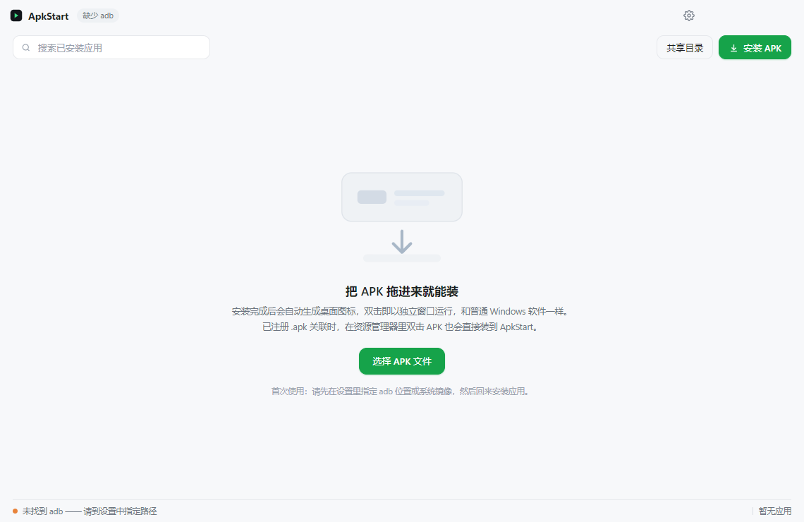
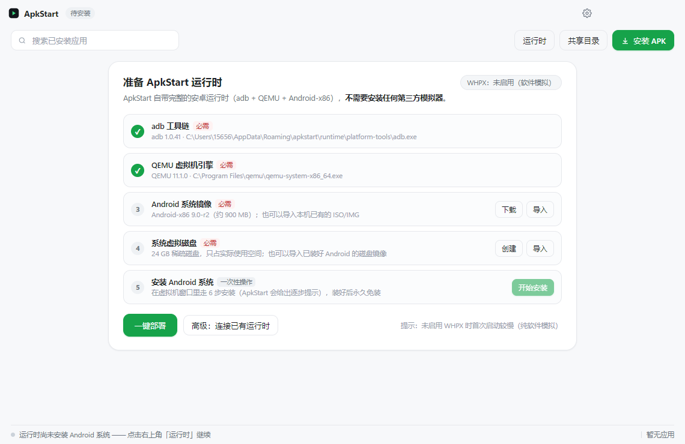

# ApkStart

<p align="center"></p>

[](https://github.com/RoutineMiku/apkstart/actions/workflows/ci.yml)
[](https://github.com/RoutineMiku/apkstart/releases)
[](LICENSE)
[](#)

**English** · [简体中文](README.zh-CN.md)

**An Android app runner for Windows — Android apps install and behave like native Windows software.**
Note: this is an early-stage project, built for fun in evenings and weekends, open source, free, ad-free and not yet especially polished. It has never been promoted.

- 🖱️ **Double-click an .apk to install**: with the file association registered, double-clicking an APK in Explorer parses it, installs it and creates a desktop icon — no emulator UI involved.
- 🧩 **One desktop icon per app**: the icon is extracted from the APK offline and converted to a multi-size ICO. Double-clicking it launches that app, just like opening a native Windows program.
- 🪟 **An app is a window**: the runtime starts **with a window** (headless mode produces no VSYNC, so the app process lives but the screen stays empty). ApkStart retitles that window, swaps in the real app icon and sizes it to the app's aspect ratio, which makes it an app window; **fullscreen** fills the screen height and centres, **windowed** mode drags and resizes freely and remembers each app's size.
- 🔍 **Findable from Windows**: installation creates both a desktop and a Start menu shortcut (`Programs\ApkStart\`), so typing the app name in Start reaches it, and the taskbar groups per app.
- 📁 **Shared files**: `%USERPROFILE%\ApkStartShared` ↔ `/sdcard/ApkStartShared` inside Android, synced both ways continuously, so files saved by Android apps appear on the host.
- 🪶 **Extremely light**: the shell has zero third-party dependencies (ZIP, PNG, ICO and AXML parsing are all hand-written); the runtime starts on demand and is reclaimed when idle.



```
┌────────────────────────────────────────────────────────────┐
│  Desktop icon (real app icon, .lnk)                        │
│      │  double-click                                       │
│      ▼                                                     │
│  ApkStart.exe --launch <package>                           │
│      │  Runtime not running? → started automatically       │
│      │  (Android Emulator + API 34)                        │
│      ▼                                                     │
│  Launch the LAUNCHER entry the system resolves             │
│  (not the main activity hard-coded in the APK)             │
│      │  Watched for 18 s; crash → retry / reset / grant    │
│      ▼                                                     │
│  Emulator window = app window (title, icon, portrait       │
│  ratio, fullscreen and centred)                            │
└────────────────────────────────────────────────────────────┘
```

## Download and run (no build)

Both mirrors carry identical files; inside mainland China Gitee is much faster:

- GitHub: [github.com/RoutineMiku/apkstart/releases](https://github.com/RoutineMiku/apkstart/releases)
- Gitee: [gitee.com/daily-miku/apkstart/releases](https://gitee.com/daily-miku/apkstart/releases)

Packages (four shapes, identical content and version):

| Build | File name | When to choose it |
|---|---|---|
| Store | `ApkStart_<four-part version>_x64.msix` | Installed from Microsoft Store. Full runtime included, no network after install; self-updates via the Store |
| Full portable | `ApkStart-v*-win64-full.zip` (~830 MB, ~1.3 GB unpacked) | **No install and no waiting for a download**: unzip and run, the runtime (emulator + system image) is inside |
| Installer | `ApkStart-v*-Setup.exe` (~1.3 GB) | You want desktop/Start menu shortcuts and an uninstall entry |
| Light portable | `ApkStart-v*-win64-portable.zip` (96 MiB, ~227 MB unpacked) | Just trying it; the runtime downloads on first start |

> Every `ApkStart.exe` carries the **brand icon and version resource** (FileDescription = `ApkStart Android app runner`,
> CompanyName = `RoutineMiku`, version in sync with `package.json`), not the default Electron icon and `33.x` version.
> Building from source: `npm run pack` (light) / `npm run pack:full` (full) / `npm run build:msix` (Store package).

### How fullscreen actually works

The emulator's **physical panel orientation** (`hw.lcd.width/height`) *is* the shape of the picture. When the panel disagrees with the `screenOrientation` the app declares, Android gives the app a letterboxed strip in the middle — black bars either side — and neither resizing the window, changing `wm size` nor tweaking letterbox styles fills it (each was tried; see the notes in `src/core/apk.js`).

So ApkStart **parses `AndroidManifest.xml` offline at install time**, works out whether the app is naturally landscape or portrait (weighted by the launch activity; apps declaring `sensor` / `fullSensor` are asked once after the first run), stores it in `apps.json` and picks the panel from it at launch:

- Portrait apps such as Hongguo Free Drama → portrait panel 720×1280, upright, filling the window, density 190 (sw606dp), which also yields the tablet layout;
- Landscape apps such as Modu Reading → landscape panel 1280×720, upright, filling the window.

The runtime only restarts on the one occasion when the panel and the app disagree (about 40 seconds, announced in the title bar); afterwards apps of that orientation open in seconds. The rotate button in the title bar **remembers** the orientation for that app (others are unaffected), and Settings → App window → Screen orientation can force landscape or portrait.

Layout follows logical density: 720 px at 190 dpi is **606 dp**, just past Android's 600 dp tablet breakpoint, which is the only density where Hongguo's two-column episode grid and split settings appear (the image's default 320 dpi gives 360 dp, a phone layout). That is the "Tablet layout" switch in settings, on by default; turning it off returns to the phone layout.

### Online updates (fastest source picked live)

Settings → **Software update** → "Check for updates", or right-click the tray → "Check for updates", then "Update now".

- The installer build downloads `ApkStart-v*-Setup.exe` and installs it silently;
- The portable build downloads `ApkStart-v*-win64-portable.zip` and overwrites the **program folder** — the runtime folder (`%APPDATA%\apkstart\runtime`), installed apps and snapshots live outside it, so nothing is lost;
- The replacement is done by a separate PowerShell script (wait for the main process to exit → overwrite → relaunch), so there is **no "please close the program" dialog** and no emulator window left on the desktop.

The updater does not hard-wire GitHub; it **measures and chooses every time**:

1. Ask GitHub and Gitee for the latest version at the same time and take the higher one (a timeout or block on one does not affect the other);
2. List "direct source / same-named Gitee asset / mirror prefix" as candidates, download 256 KB from each to measure throughput counting only **after the first byte** (so a high-latency, high-bandwidth source is not misjudged as slow);
3. Sort by measured speed and download the fastest in parallel chunks, switching source on failure.

"Download and update sources" in settings can pin a single side (for corporate networks that only allow one domain), disable public mirrors, or use your own mirror prefix. Gitee caps attachments at 100 MB per file, so the portable package uses 7-Zip deflate (`-mx=9`) to land at **95.0 MB**, which makes it a single archive you can double-click and extract on Gitee too (the old `.part1/.part2` scheme is gone). The two mirrors' packages differ slightly in size; the client downloads one source to completion rather than mixing them.

Both repositories are public and Gitee's release list is readable anonymously, so no token is needed. (Only when Gitee rate-limits with 403/429 does a read-only token in settings raise the quota.)

**Defaults you get out of the box** (no settings trip required):

- Starts with Windows, sits in the tray; double-clicking a desktop icon goes straight into the app.
- Installing an APK creates **desktop and Start menu** shortcuts, so Windows search finds the app by name; shortcuts missed by older versions are filled in at startup.
- App windows render natively (not a screen mirror): **fullscreen** fills the screen height, centred, keeping the phone aspect ratio; **windowed** mode stays portrait, drags and resizes freely and remembers each app's size. `F11` or the tray menu toggles.
- Runtime permissions the app requests are granted automatically, so it never hangs on a system prompt; a crash is retried automatically, with an app-data reset if needed.
- **Networking uses the host's network**: Android goes through QEMU user-mode NAT and reuses the host's physical adapter, so **no virtual adapter or switch is created on Windows** (no driver, no extra network device, no network configuration).

## Settings: categorised and searchable

Since 0.6.0 the settings are grouped into eight categories with a navigation column on the left:

| Category | What it holds |
|---|---|
| Common & installation | Runtime and environment, one-click setup, start with Windows, disk usage and cleanup |
| Display & window | Display mode, auto fullscreen, screen orientation, image auto-rotate, tablet layout, window hosting, Android system settings |
| Controls & input | Mouse buttons, key mapping (gamepad) |
| Performance & resources | Resource policy, quality, data partition, system language, Chinese IME, snapshots, pre-warming, advanced parameters |
| Network & downloads | Update and download sources, public mirrors, download threads |
| Diagnostics & repair | Machine health check · auto-configuration, drivers · compatibility patches, automatic checks · smart diagnostics |
| Integration & files | Desktop and apps, shared files, system integration |
| Update & about | Software update, about |

A search box on top matches **across categories** — typing "landscape", "memory" or "proxy" never produces a hit you cannot see. The last category you were on is remembered.

## Automatic detection (auto-debug)

Settings → **Diagnostics & repair** → "Automatic checks · smart diagnostics". The machine is inspected periodically and problems are grouped:

- **Runtime**: the real reason the last start failed, boot hangs, leftover lock files, orphan emulator processes, empty snapshots, no hardware acceleration
- **Device connection**: adb not authorised (Android asked "Allow USB debugging?" and nobody clicked), offline, runtime running but adb cannot see the device
- **Storage**: free disk, data partition differing from its configured value (an overlay disk blocking growth), shared folder not writable
- **Settings**: orientation policy fighting the physical panel, auto fullscreen ineffective in native window mode
- **Network / log**: no network inside Android, unreachable download sources, errors in the recent log

Every problem has a one-click fix (restart the runtime, clear locks, kill orphans, discard snapshots, clean disk, reset Android networking…), followed by an automatic re-check.

Two rules: **a failed probe is never reported as a problem** (no status means "unknown", never a guess), and **a problem is announced once** (old ones stop nagging and are only logged when they clear). Every 10 minutes by default; the interval can be changed or the checks turned off on the same page.

## Build from source

```powershell
# 1. Install dependencies (including the Electron runtime)
npm install

# 2. Start and complete the runtime deployment (one-off download of adb / Android Emulator / system image)
npm start

# 3. (Optional) register .apk double-click installation
npm run assoc:on

# 4. Package the portable build (no install, ready to distribute)
npm run pack
# output: dist/ApkStart-win64-portable/ApkStart.exe
# 5. Zip it for release (use this script, not Compress-Archive: that adds 5 MB and will not fit on Gitee)
node build/zip.js dist/ApkStart-win64-portable ApkStart-win64-portable.zip
```

### Single-file EXE (runtime inside, no network after install)

If you want "one EXE, double-click and run, no waiting for downloads":

```powershell
# First turn engine/ into a distributable runtime (system.img packed with xz/LZMA2 at maximum,
# 3.1 GB → ~1.1 GB; the emulator is trimmed of parts that are never used: arm64 QEMU, the Vulkan
# backend, extra language packs, qsn/self-check tools, VR resources)
npm run runtime

# Then build the installer EXE (electron-builder nsis target, installs into the user profile)
npm run build:exe
# output: dist/release/ApkStart-<version>-Setup.exe
```

Measured size breakdown: Electron ~180 MB, trimmed emulator ~480 MB, xz-compressed system image ~1.1 GB, installer ~1.32 GB (about 490 MB less than the gzip scheme). The hard floor is `system.img` itself — it is the Android system, verity-protected, and its GMS components cannot be trimmed from outside. Networking uses host NAT and creates no virtual adapter, so no extra driver is needed.

The first start expands the xz image into `%APPDATA%\apkstart\system-images` (~20 seconds, once only) and reuses it afterwards. The AVD and installed apps always live in `%APPDATA%\apkstart\avd`, so even a portable build unpacked into a temporary folder loses nothing.

## Runtime: fully self-contained, no third-party emulator

ApkStart is **self-hosting**: it downloads, verifies and manages every runtime component itself (in `%APPDATA%\apkstart\runtime`). The light build fetches the whole package from **this project's GitHub releases** (`ApkStart-runtime-*.zip`) and falls back to the official sources below only if that fails:

| Component | Source | Size | Purpose |
|---|---|---|---|
| adb (platform-tools) | dl.google.com, official | ~8 MB | Install and launch Android apps |
| Android Emulator | dl.google.com, official (8-thread parallel download) | ~440 MB | Runtime engine (device model and GPU translation included) |
| Universal Android 14 system image (Google Play x86_64) | dl.google.com, official | ~3.1 GB source (~1.1 GB as xz) | The only base layer: x86 apps, ARM-only apps and GMS all run on it; the image is the system, nothing to install |
| AEHD driver (optional) | dl.google.com, official | ~0.2 MB | Hardware acceleration (or WHPX via Windows "Virtual Machine Platform") |

On first use the "Runtime" page walks through the deployment (**one-click setup**):
1. adb, the runtime engine and the system image download automatically (measured at 10+ MB/s from the official source);
2. when deployment finishes it **boots automatically**, and from then on double-clicking a desktop icon brings it up invisibly.



**Device compatibility (handled automatically)**

- Without hardware acceleration it falls back to software emulation; a failed start is retried with up to four parameter sets (renderer backend → acceleration path → memory / cold boot).
- `-gpu` is chosen from the engine version (37.x uses `software`, older builds `swiftshader_indirect`), never a deprecated mode.
- Memory and cores are derived from physical memory (2–4 GB / 2–4 cores), the data partition drops from 16 GB to 4 GB, ports are picked from what is free, non-ASCII paths become short paths and AVD locks are cleared automatically.
- Failure reasons are translated and come with a fix suggestion; "Export diagnostics" is in settings.
- Large downloads use **8-thread chunking with resume**, falling back to a single stream for sources without Range support.
- **Only its own runtime**: ApkStart does not probe, take over or drive MuMu / LDPlayer / BlueStacks / WSA. Whether they are installed, how they upgrade and which ports they use makes no difference. There is no "switch engine" option any more.
- **Machine health check · auto-configuration**: after installation it checks CPU virtualisation (VT-x/SVM), the Windows hypervisor platform, GPU and VRAM, memory and OS version; what it can change (memory / cores / quality / renderer backend) is written into settings and frozen as a driver, what needs admin gets a button, and what only BIOS can change comes with instructions. See [docs/preflight.md](docs/preflight.md).
- **Driver (compatibility patch) extension**: if a machine only runs with different launch parameters (old GPU with low GLES support, no hardware acceleration, a driver that crashes with hardware rendering), write a JSON patch that declares which machines it matches and which parameters to change. Settings can import, enable and export a template for the current machine; a patch only touches whitelisted launch options and executes no code. See [docs/drivers.md](docs/drivers.md).

**Container-style low-cost operation**

- **Read-only base layer**: `system-images/` exists once per machine and is shared by every app; no more AOSP + compatibility image pairs.
- **Thin writable layer**: each AVD uses differential user data plus a named quickboot snapshot; when the last app window closes (and the runtime goes idle) the memory state is saved, so the next start restores instead of cold-booting.
- **Idle pre-warm (on by default)**: like WSA or Tencent's App Store on PC, ApkStart boots the Android environment in the background (window fully hidden) so opening an app is one `am start`; the cost is about 1 GB resident memory when idle, and it can be turned off.
- **Faster cold boot**: acceleration and engine-version probes are cached on disk (invalidated by exe fingerprint), pointless `wmic` process enumeration is skipped, boot polling adapts its interval (from 350 ms) and guest preparation is a single adb round trip; 5–10 seconds saved per start.
- **`/data` is created by ApkStart itself**: the official image ships a 1 MB all-zero `userdata.img` placeholder and the SDK tools normally format it — starting `emulator.exe` directly skips that, so `/data` fails to mount, the guest drops into a recovery loop and the symptom is "several minutes and it still will not open". The first start now generates a 4 KB-block ext4 with `ENCRYPT` (file-based encryption) and `ext_attr` (SELinux labels) and grows it to the configured size with the bundled `qemu-img` + `resize2fs`. Measured: ~23 seconds cold, ~10 seconds from a snapshot.
- Snapshot integrity checks: empty shells left by an interrupted save (a `snapshot.pb` of a few dozen bytes) are detected and cleaned; newer emulators write `ram.bin` (older ones `ram.img`) and both names are accepted, so a fresh 3 GB snapshot is no longer mistaken for an empty shell and deleted.
- **No console windows at all**: qemu's console window belongs to `conhost.exe`, so its pid never matches qemu and a pid whitelist hides nothing; the emulator's network daemon `netsimd` pops up another black window. Suppression now starts **before** the emulator, falls back to window class/title matching (emulator / qemu / netsim) and scans every 120 ms for the first 90 seconds.
- **The app only shows the app**: the emulator's main window (`Android Emulator - apkstart5554`) never appears on the desktop on its own — it is either suppressed or already embedded into the app window with `SetParent`. Closing an app window detaches and hides it **first**, then destroys the host (the reverse order makes Windows re-parent it to the desktop and show it); after an app exits the window agent keeps watch for up to 3 minutes so an emulator quitting mid-boot cannot reveal a black window seconds later.
- **Download on demand**: the universal image is only completed when an ARM-only app appears; `.apks` / `.xapk` split packages install with `install-multiple`.
- **Reclaimable**: non-x86_64 QEMU targets (~400 MB) are trimmed at build time; settings can clean old images, snapshots, lock files and abandoned AVDs.

## Directory structure

```
apkstart/
├─ src/
│  ├─ main.js              main process: windows/tray/single instance/CLI dispatch/IPC
│  ├─ preload.js           secure bridge
│  ├─ ui/                  renderer (plain HTML/CSS/JS, no framework)
│  ├─ i18n/                English dictionary (Chinese-is-the-key) + extractor output
│  └─ core/
│     ├─ zip.js            minimal ZIP reader (decompress on demand)
│     ├─ axml.js           Android binary XML parser
│     ├─ arsc.js           resources.arsc table parser (app name / icon path)
│     ├─ apk.js            APK metadata: package/version/launch activity/icon/ABI
│     ├─ png.js            dependency-free PNG encoder + programmatic icon drawing
│     ├─ shortcut.js       multi-size ICO generation + .lnk shortcuts
│     ├─ assoc.js          .apk file association (HKCU, no admin)
│     ├─ adb.js            adb client (install/launch/sync/screenshot/…)
│     ├─ engine.js         runtime management: probe/emulator hosting/idle reclaim
│     ├─ sharer.js         host ↔ Android shared folder sync
│     ├─ installer.js      installation pipeline
│     ├─ i18n.js           main-process translation (dialogs, tray menus)
│     └─ store.js          app list and settings persistence
├─ engine/                 runtime component download cache (emulator / system-images / platform-tools)
├─ tools/platform-tools/   portable adb drop-in
├─ tools/i18n-*.js         string extractor and dictionary compiler
├─ test/                   unit tests + Electron integration tests + smoke screenshots
├─ build/pack.js           portable packaging
└─ scripts/assoc.js        .apk association CLI switch
```

## Command line

```
ApkStart.exe                      open the main window
ApkStart.exe <path\to.apk>        install an APK
ApkStart.exe --launch <package>   start an app directly (what desktop shortcuts use)
```

## Tests

```powershell
npm test                                   # pure Node unit tests + engine path tests (no network)
npm run test:boot                          # real boot test: 61 MB Alpine guest, QEMU args/disk/graceful shutdown
npm run selftest                           # runtime self-test: install → launch → screenshot → shared folder
electron test/electron-integration.js      # ICO / shortcut integration tests
electron . --smoke test\shot.png           # start the app and screenshot it (UI smoke test)
```

`npm run selftest` is the acceptance command once Android is installed: it checks the adb connection, the Android version, freeform support and two-way shared-folder sync, and with `--apk some.apk` it walks install → native window launch → foreground check → screenshot.

## Design trade-offs (honestly)

- **Not a hypervisor written from scratch**: the Android kernel, GPU translation and the ART runtime are years of engineering; this project stands on AOSP/QEMU/adb and concentrates its effort on the "native app experience" — the same architectural bet Tencent's App Store on PC and Google Play Games for PC make.
- **The shared folder syncs rather than mounts**: Windows cannot mount an NTFS directory inside Android without root, so second-level two-way sync delivers the same experience.
- **ARM-only / ByteDance apps**: enabling "ARM compatibility mode" switches to the **Android 14 (API 34) Google Play image** with the newer `ndk_translation` layer, so apps that only ship ARM native libraries install and run. **Measured: Hongguo Free Drama (com.phoenix.read, arm64-v8a-only) installs, reaches its recommendation feed and plays video** — on the old API 30 image ByteDance's non-standard signal handler tripped the layer's protective assertion (`DoBadTrampoline` SIGABRT), which the newer layer on Android 14 fixes. A few apps carry deeper anti-emulation checks (verifying real sensors or the baseband) and may still be limited; when an install fails or an app crashes, ApkStart explains why in plain language.

| Hongguo Free Drama in compatibility mode (Android 14 · AEHD acceleration) |
|:---:|
|  |

### "Hardware acceleration is off" — what to do

An Android emulator has only two acceleration paths on Windows:

| Path | What it is | Needs admin | Reboot after |
|---|---|---|---|
| **WHPX** | The built-in "Windows Hypervisor Platform" feature | To enable it | Yes |
| **AEHD** | Google's own kernel driver | To install it | No |

- **Installer / portable**: Settings → Environment check → click **Repair** next to "Hardware acceleration is off". One UAC prompt appears and WHPX is enabled; if that fails (unsupported system, or you decline), the AEHD driver is installed instead.
- **Microsoft Store (MSIX)**: Store apps **cannot elevate themselves**, so "Repair" opens the "Turn Windows features on or off" dialog — tick **"Windows Hypervisor Platform"** (HypervisorPlatform), click OK and **reboot** once.

  You can also run this in an administrator PowerShell:

  ```powershell
  dism /online /enable-feature /featurename:HypervisorPlatform /all /norestart
  dism /online /enable-feature /featurename:VirtualMachinePlatform /all /norestart
  ```

> Do not enable only "Virtual Machine Platform (VirtualMachinePlatform)" — that is what WSL2 needs. The emulator needs **"Hypervisor Platform (HypervisorPlatform)"**. With only the former, `emulator -accel-check` still reports unavailable.
>
> It runs without acceleration too (pure software emulation), just with a boot that takes minutes — that is what the in-app notice is about, not a start failure.

### Desktop icon wrong / shows the ApkStart icon

Every Android app's desktop shortcut should use **its own icon** (extracted from the APK at install time into `%APPDATA%\apkstart\icons\<package>.ico`). If it shows the green ApkStart play button, or a blank icon:

1. **Settings → System integration → Rebuild shortcuts** (rewrites the desktop and Start menu shortcuts from the current app list, fixing icons and taskbar identity too);
2. If that does not help, delete the shortcut and right-click the app in ApkStart → recreate the shortcut / reinstall once.

> Why it breaks: early versions pointed every `.lnk` `IconLocation` at the ApkStart brand icon, and moving the portable folder elsewhere invalidates the absolute paths recorded in the shortcuts. Rebuilding fixes both.
>
> Each app's shortcut also carries its own AppUserModelID, so **pinning to the taskbar** keeps the app's own icon rather than mixing in ApkStart's.

### Why does my `adb devices` not show the Android device

ApkStart's adb server runs on a **dedicated port 5044**, fully separate from your own adb (5037) — so Android Studio or scrcpy never fight it for the device and it never kills an emulator you started by hand.

To connect from the command line:

```powershell
$env:ANDROID_ADB_SERVER_PORT = 5044
adb devices              # should list emulator-5554
```

⚠️ Do **not** `adb connect` to port 5555 by hand: the Play system image shows the "Allow USB debugging?" system dialog on top of the running Android app, which looks like the program is broken.

## About the author

ApkStart is developed and maintained by **RoutineMiku**.

- GitHub: <https://github.com/RoutineMiku/apkstart>

<p align="center"></p>

<p align="center"><i>Powered by <b>RoutineMiku</b></i></p>

## Contributing

Issues and pull requests are welcome. The shell stays free of third-party dependencies; run `npm test` before submitting. Details in [CONTRIBUTING.md](CONTRIBUTING.md).

## License

[MIT](LICENSE). Release packages contain only ApkStart's own code and the Electron runtime — no Android system images, QEMU binaries or Google components are redistributed; those are downloaded from official sources on the user's machine at first start and are governed by their own licences.
